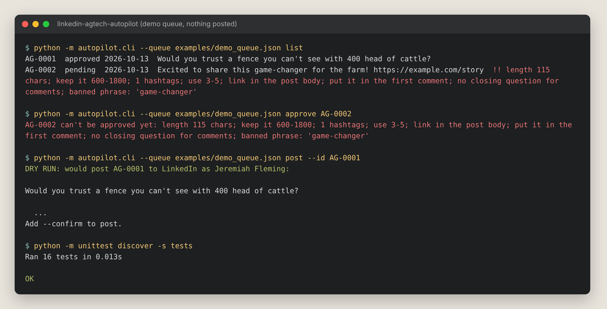
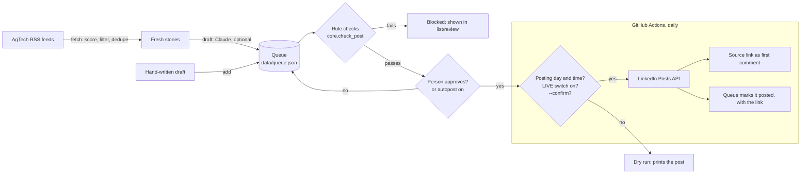

# LinkedIn AgTech Autopilot

A small, free pipeline that keeps a LinkedIn profile active with useful AgTech posts, without giving up control of
what goes out under your name. It reads AgTech news every day, queues post drafts, checks each one against a written
set of rules, and publishes approved posts three times a week from GitHub's servers. It costs nothing to run.

I set it up, with Claude Code, for my own LinkedIn, where it has run since October 2026. It shows how I approach an
operations problem:
write the rules down, automate the repeatable part, keep a person on the decisions that matter, and make every step
visible and reversible.



## What it does

| Step | Command | What happens |
|---|---|---|
| Fetch | `python -m autopilot.cli fetch` | Reads AgTech RSS feeds, drops stale or off-topic stories, scores the rest by keyword and removes duplicates. |
| Draft | `python -m autopilot.cli draft --count 3` | Optional. Claude writes drafts from the best stories, following the voice and rules in `config.toml`. Drafts can also be written by hand (`add`). |
| Check | runs on every draft | Length, hook length, hashtag count, no link in the body, a closing question, banned buzzwords and private terms. A draft that fails can't be approved or posted. |
| Review | `list`, `review`, `approve`, `edit`, `reject` | A person reads the queue and approves what should go out. |
| Post | `python -m autopilot.cli run --confirm` | On posting days after the posting time, publishes at most one approved draft, then adds the source link as the first comment. |

## How it works



The queue is a JSON file kept in the repository, so the daily cloud job and a local run share one source of
truth, and every status change is in the git history.

## Design choices

- **Safe by default.** Three separate switches must all be on before anything posts: a draft is approved (or
  `autopost = true`), the `LINKEDIN_LIVE` repository variable is `true`, and the command runs with `--confirm`. Without
  them, every command is a dry run.
- **Rules live in config, not code.** Voice, topics, banned phrases, posting days and feeds are all in `config.toml`.
  Pointing it at another industry is a config change.
- **No invented background.** The drafting model may only use personal facts listed in `[facts].approved`; with
  that list empty it writes from the news and from questions.
- **Link in the first comment.** LinkedIn shows posts with outside links to fewer people, so the source goes in a
  comment the pipeline adds right after posting.
- **Standard library only** for fetching, checking and posting. The optional drafting step needs `anthropic` and
  `pydantic` (`requirements-draft.txt`).
- **Stays inside LinkedIn's terms.** It uses the official Posts API with your own sign-in. It doesn't scrape,
  send invitations or send messages; networking stays a human job.
- **Fails loudly, not silently.** A LinkedIn error marks the draft `failed` with the reason; a dead feed is skipped
  and reported; the job warns a week before the 60-day login runs out.

## Project layout

```
autopilot/
  core.py      feed parsing and scoring, the queue, post checks, LinkedIn API client
  cli.py       the commands: fetch, draft, add, list, review, approve, edit, reject, post, run, whoami
  connect.py   one-time LinkedIn sign-in (OAuth), saves the login to .env
  env.py       minimal .env loader
config.toml    every rule and setting
data/queue.json            the live queue (starts empty)
examples/demo_queue.json   two demo drafts used in the screenshot
tests/         16 unit tests, LinkedIn's API replaced by a fake
.github/workflows/autopilot.yml   the daily cloud job (tests, then run)
```

## Run it yourself

Requires Python 3.11 or newer.

```bash
python -m unittest discover -s tests                       # 16 tests, no network
python -m autopilot.cli --queue examples/demo_queue.json list
python -m autopilot.cli --queue examples/demo_queue.json post --id AG-0001   # dry run, posts nothing
python -m autopilot.cli fetch                               # live news, posts nothing
```

### Connect a LinkedIn account

1. At https://www.linkedin.com/developers/apps, create an app (LinkedIn asks for a company Page to attach it to).
   Add the products **Share on LinkedIn** and **Sign In with LinkedIn using OpenID Connect**, and the redirect URL
   `http://localhost:8767/linkedin/callback`.
2. Copy `.env.example` to `.env`, fill in `LINKEDIN_CLIENT_ID` and `LINKEDIN_CLIENT_SECRET`, then run
   `python -m autopilot.connect` and sign in. It saves the login to `.env`; `.env` is never committed.
3. `python -m autopilot.cli whoami` checks the login without posting.

### Turn on the daily cloud job

In the repository's **Settings > Secrets and variables > Actions**:
- Secrets: `LINKEDIN_ACCESS_TOKEN` and `LINKEDIN_PERSON_URN` from `.env` (optional `ANTHROPIC_API_KEY` for drafting).
- Variables: `LINKEDIN_TOKEN_EXPIRES` from `.env`, and `LINKEDIN_LIVE` = `true` when you're ready to post.

LinkedIn member logins last about 60 days. Re-run step 2 and update the secret before then.

## License

MIT
